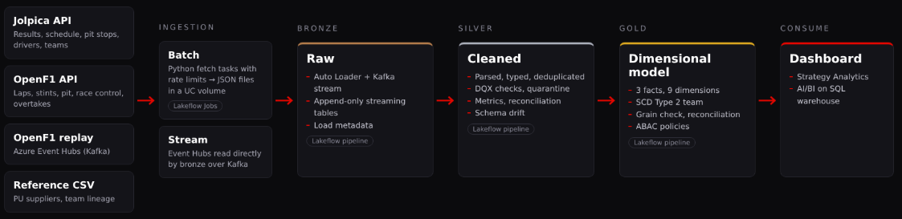
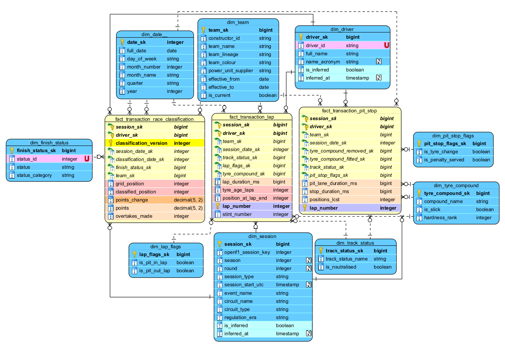
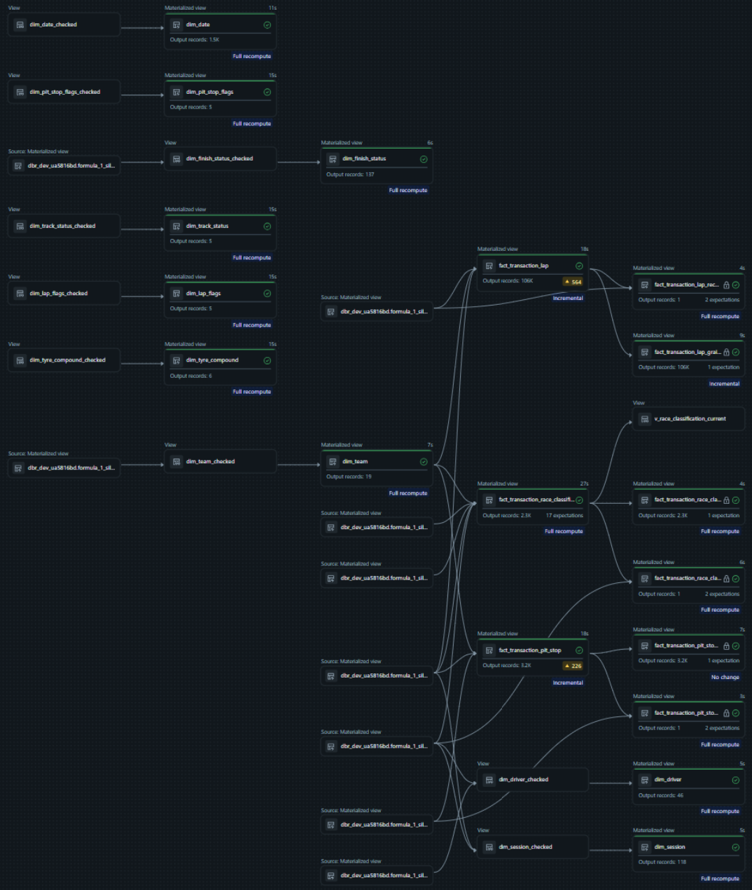
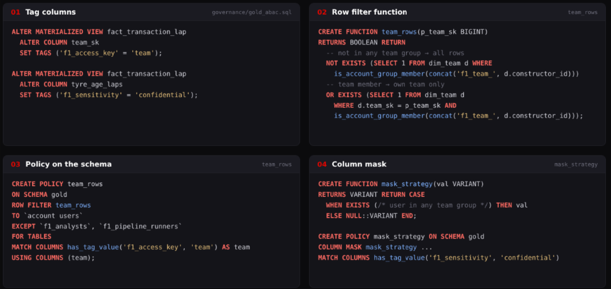

# Formula 1 Lakehouse

An end-to-end data platform for Formula 1 race strategy analytics, built on Databricks with Lakeflow Declarative Pipelines and Unity Catalog. Team project at SoftServe Academy.

## Data

| Source | What | How |
|---|---|---|
| [Jolpica API](https://github.com/jolpica/jolpica-f1) (Ergast successor) | Schedule, race and sprint results, pit stops, drivers, constructors, finish statuses | Batch, paged JSON |
| [OpenF1 API](https://openf1.org) | Sessions, meetings, drivers, laps, stints, pit stops, race control, overtakes, positions | Batch JSON for Race and Sprint sessions |
| OpenF1 replay | Live-style session events | Stream via Azure Event Hubs (Kafka) |
| Reference CSV | Power unit suppliers per team and season, team lineage | Static files in the repo |

Seasons **2023–2026**, Race and Sprint sessions only. Gold volume after the latest run:

| Table | Rows |
|---|---|
| `fact_transaction_lap` | 106 254 |
| `fact_transaction_pit_stop` | 3 218 |
| `fact_transaction_race_classification` | 2 264 |
| `dim_session` | 118 |
| `dim_driver` | 46 |
| `dim_team` (SCD2 versions) | 19 |

## Architecture

Medallion architecture, one Lakeflow pipeline per layer, deployed with Databricks Asset Bundles.

- **Bronze** – raw JSON from both APIs and the stream, append-only, with load metadata.
- **Silver** – parsed, typed and deduplicated tables with DQX checks, quarantine, row-balance metrics, bronze-to-silver reconciliation and schema drift detection.
- **Gold** – dimensional model for analytics (described below).
- **Data quality** – separate DQ jobs per layer, results stored in Delta tables.
- **Dashboard** – Formula 1 Strategy Analytics in Databricks AI/BI.

## Gold layer and governance – my part

### Dimensional model

A **fact constellation**: three transaction facts for three business processes, sharing conformed dimensions.

| Fact | Grain |
|---|---|
| `fact_transaction_race_classification` | Session × driver × classification version |
| `fact_transaction_lap` | Session × driver × lap |
| `fact_transaction_pit_stop` | Session × driver × lap |

- **Classification versions.** Results change after penalties, so each published version is a row. `points_change` adds up to the final points, and `v_race_classification_current` shows the latest version.
- **Dimensions.** Date, session, driver, team, finish status, tyre compound, track status, and two junk dimensions for lap and pit stop flags.
- **Role-playing dimensions.** `dim_date` for session and classification dates, `dim_tyre_compound` for removed and fitted tyres.
- **Degenerate dimensions.** `lap_number` and `classification_version` stay in the facts.
- **Informational PK and FK constraints** in Unity Catalog document the joins.

### Keys

- **Deterministic surrogate keys** – the same silver data always gives the same keys, even after a full recompute. Most keys are `xxhash64` of the natural key: fast, non-cryptographic, a BIGINT.
- **Order-preserving keys** where range filters matter: `session_sk` encodes season, round and session type (`2025242`), `date_sk` is `YYYYMMDD`. A hash would scatter neighbouring sessions, and clustering couldn't skip files.
- **Unknown member** `-1` in every dimension – facts never lose rows, and inner joins stay safe.
- **Late-arriving dimensions** – a driver or session seen only in results is added as an inferred member with the same key the real row gets later.
- Dimensions keep the natural key next to the surrogate key for traceability.

### SCD Type 2 – `dim_team`

A new team version starts when the power unit supplier changes. Versions are built with the **gaps-and-islands** pattern: `lag` flags changes, a running `sum` numbers the versions, `groupBy` collapses each version into one row with `effective_from`, `effective_to` and `is_current`.

Neither MERGE nor AUTO CDC is used: both keep state and order versions by arrival. Silver already holds the full history, so a materialized view rebuilds it deterministically from seasons.

Facts find the team version valid on the event date with a range join. `dim_team` has a broadcast hint – about 44 bytes per row, far below the 10 MB threshold.

### Lakeflow pipeline

- All gold tables are **materialized views**. Lakeflow picks incremental refresh or full recompute per update by cost.
- A **factory** registers every table in a few lines: schema, keys, expectations and checks are added automatically.
- **Dimensions** are validated with DQX on a temporary view **before publishing** – a duplicate key would multiply every fact joined to it.
- **Facts** are validated **after writing**, so they can stay incremental:
  - expectations on keys – `NOT NULL` fails the update, unknown keys are counted as warnings;
  - a private **grain check** fails the update on any duplicate;
  - a private **reconciliation** table compares row counts with silver – lost rows fail the update, rows excluded on purpose raise a warning. For classification it also checks that points changes add up to the final points.

### Access control – ABAC

Attribute-based access control with governed tags and schema-level policies in Unity Catalog (`governance/gold_abac.sql`).

| Who | Rows | Strategy columns |
|---|---|---|
| `f1_analysts` | All | Visible |
| `f1_team_<team>` | Own team only | Visible |
| Everyone else | All | `NULL` |

- **Tags** mark the team column for row filtering and strategy columns as confidential.
- **Row filter** – team engineers see only their own team's rows, so they can't see rivals' strategy. Access is checked by group membership, so there is no mapping table.
- **Column mask** – one `VARIANT` function masks columns of any type.
- **Policies** are defined once on the gold schema and find columns by tag, so a new table only needs tags. Analysts and the pipeline identity are excluded – the pipeline must always read full data.
- The script lives in the repository and runs only when access rules change.

## Tech stack

Databricks · Lakeflow Declarative Pipelines · Unity Catalog · Delta Lake · PySpark · DQX · Azure Event Hubs · Databricks Asset Bundles · GitHub Actions · pytest

## Team

- **https://github.com/dan-vader** – bronze layer, ingestion and streaming
- **https://github.com/olesJS** – silver layer and observability
- **Roksolana Shendiukh** – gold layer, dimensional modeling and governance
- **https://github.com/natalyamartuniyk** – data quality and testing
